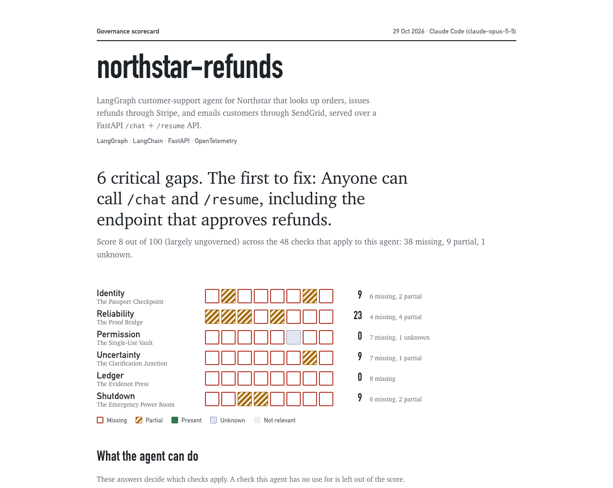
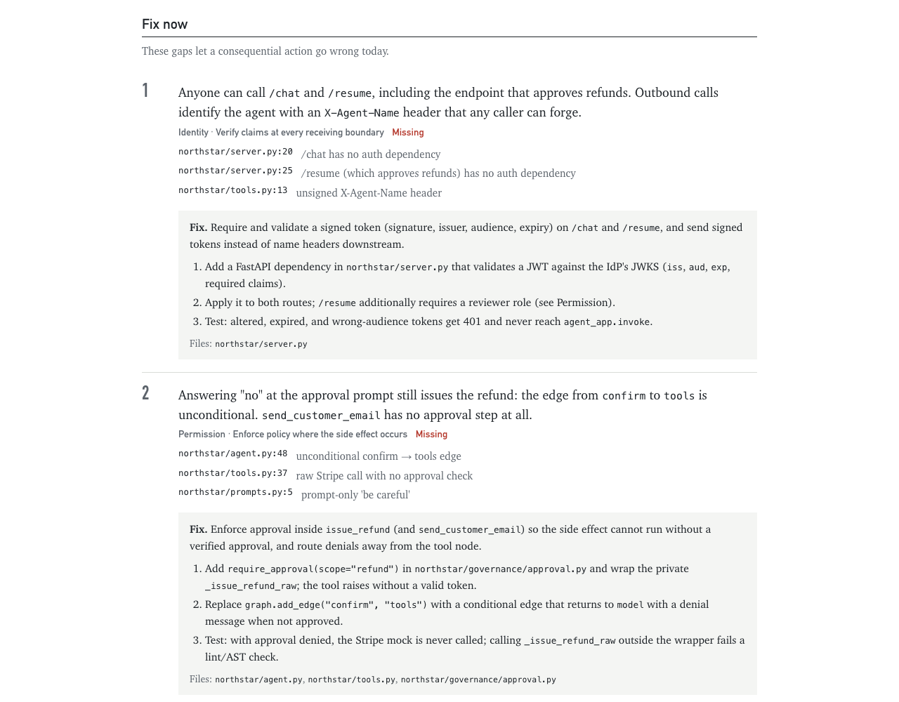

# Agent Governance Scorecard

**Find out what your AI agent can get wrong today, and exactly which lines to change.**

```bash
npx skills add liwoo/agentic-governance-skills
```

Then ask your coding agent (Claude Code, Cursor, Codex, Copilot, whatever you use):

> Run a governance scorecard on this repo.

Give it about as long as a coffee and you get back a report that reads like a building survey of your agent: every safeguard checked, every gap traced to a file and line, and a short list of what to fix first.



---

## Why I built this

Here's a bug I planted in the sample agent that ships with this repo.

Northstar's refund agent asks a human before issuing a refund. There's a LangGraph `interrupt()`, a nice little "Allow?" prompt, the works. It looks governed. It passes the demo.

But the edge from the approval node to the tool node is unconditional. So when the reviewer says **no**, the refund goes out anyway.

The way you catch that is by reading the code path between "the model suggested an action" and "our system actually did it". That path is the whole job of this skill, and it found the bug in a single pass:



---

## What you get

**Findings in your code's own language.** Each finding names the real function and file. From the Northstar report: "`issue_refund` never calls `refundable_amount`, so the model's `amount_pence` goes straight to Stripe and the 30-day rule is never applied." Every claim links to the line that proves it.

**Fixes a developer can pick up on Monday.** Each gap comes with 2 to 5 concrete steps in your framework's idiom and the files to touch. Each one ends with the test that proves the fix worked.

**A fix list ranked by what can hurt you.** Gaps get a severity for *your* agent. A refund that ignores a "no" goes to the top. Tamper-proof hashing of an audit log you don't have yet goes to the bottom. You read the top 5 and you know where the week goes.

**It works with whatever you built.** The skill looks for the concept, whichever library implements it. An approval gate can be a LangGraph `interrupt`, a decorator, a middleware, a database constraint or a check in the receiving API, and it'll recognise all of them. It's been written with LangGraph, LlamaIndex, CrewAI, the OpenAI Agents SDK, Pydantic AI, Microsoft Agent Framework, Semantic Kernel and hand-rolled loops in mind. Python first, any language really.

**It only judges what your agent actually needs.** Before it scores anything, it profiles the agent with 5 yes/no questions: does it take actions, can they hurt anyone, do they run before a person approves them, does the model make the call, does it guess who you meant. A Q&A bot gets checked on Reliability and nothing else. An agent that writes drafts for a human to approve skips the approval-token checks, because the human already is the approval. The answers are printed in the report with their evidence, so anyone can argue with them.

**Honest about what code can't tell it.** Some things only your team knows, like who answers the approval queue at 2am. Those come back as specific questions for the team. The skill doesn't guess, and it doesn't hand out credit for them.

**Something to track over time.** Next to the HTML there's a `scorecard.json`. Commit it, diff it between releases, or fail CI with `--fail-under 60` when the score drops.

---

## What it checks

48 checks across the 6 safeguards from my talk, **The Governance House**. Each room asks a single question about your agent:

| Room | The question |
|---|---|
| **Identity**: The Passport Checkpoint | Can every action be traced to an owner, a build, an instance and a session? |
| **Reliability**: The Proof Bridge | Has every step earned its own test evidence, and does that evidence match what's deployed? |
| **Permission**: The Single-Use Vault | Can a consequential action run without an exact, single-use human approval? |
| **Uncertainty**: The Clarification Junction | Does the agent ask when it's unsure, or quietly guess which Alex Morgan you meant? |
| **Ledger**: The Evidence Press | If a refund half-happens, can you reconstruct what was intended, who allowed it and what actually happened? |
| **Shutdown**: The Emergency Power Room | Can you stop it mid-run, revoke its keys, and know what was in flight? |

The checks come straight from the talk's interactive site (`sites/governance-house/`). Each one has a "what good looks like" and a concrete test. The report shows both, so a "missing" always comes with a picture of what "present" would be.

---

## How it works

1. **Index.** A tiny zero-dependency script maps your repo: frameworks, tools, actions that move money or data, tests, CI. Anything that looks like a secret gets masked.
2. **Map.** Your coding agent reads the code and writes down what the agent can actually do, especially the path from model output to side effect.
3. **Scope.** It answers the 5 profile questions with evidence, and the script drops every check those answers rule out.
4. **Assess.** It goes room by room through what's left. Each check gets `present`, `partial`, `missing`, `unknown` or `not applicable`, with evidence. There are rules about what counts. A system prompt saying "be careful with refunds" is a request to the model, so it earns nothing. A confirm dialog the tool doesn't depend on only gets partial credit.
5. **Render.** The script checks that every relevant check is covered and builds the report.

It's read-only: it never runs your agent, edits your code or calls your services. The reading is done by the coding agent you already use, and the scripts run locally.

```bash
# The helper scripts work on their own too (Node 18+, no installs)
npx agent-governance-scorecard discover .
npx agent-governance-scorecard validate .governance-scorecard/report.json
npx agent-governance-scorecard render   .governance-scorecard/report.json --fail-under 60
```

Add `--link-base https://github.com/you/repo/blob/<sha>` and every piece of evidence in the report becomes a clickable link.

---

## Try it on the sample first

`examples/northstar-refunds/` is a small, deliberately half-governed LangGraph agent. It can issue Stripe refunds and send SendGrid emails, and it fails in ways that look a lot like real codebases.

Clone the repo and open [`examples/northstar-refunds/.governance-scorecard/scorecard.html`](examples/northstar-refunds/.governance-scorecard/scorecard.html) in a browser to see the full report (GitHub shows HTML files as source). It scores 8/100, and every point it loses is earned.

---

## Good to know

A score of 100 means the evidence is in the code. You'd still want to run each room's tests in staging, because a kill switch you've never pulled is mostly a theory.

The links to OECD, NIST and the EU AI Act are there to help you explain your controls. Please don't hand the score to an auditor as a certificate (I'd feel terrible).

The skill is as careful as the coding agent running it. The report records which agent did the assessment and how confident it was in each call, so you can see where to double-check.

---

## Repo layout

| Path | What's there |
|---|---|
| `skills/agent-governance-scorecard/` | The skill itself: `SKILL.md`, the 6 room guides, the assessment rules, the scripts |
| `sites/governance-house/` | The interactive talk site. Its `src/data/` is the source of truth for every check |
| `tools/catalog/` | Builds the skill's catalogue from the site data, so the talk and the skill can't drift apart |
| `examples/northstar-refunds/` | The sample agent and its report |
| `governance-skills/` | Long-form implementation guides and the [roadmap](governance-skills/PLAN.md) |
| `PRESENTATION-SCRIPT.md` | The talk track |

## Contributing

```bash
npm run build:catalog   # after editing the site's checks or tools/catalog/signals.mjs
npm test
```

If you run it on your own agent and it gets something wrong (a missed control, a false alarm, a fix that doesn't fit your framework), please open an issue with the finding. Real-world misses are how the checks get sharper.

---

Built by [Jeremiah Chienda](https://chienda.com/speaking). If your team is shipping agents that can touch money, data or customers, I'd love to hear what this finds.
